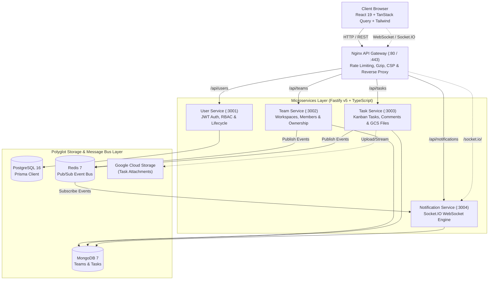

<div align="center">

  

  # Projectify

  <p align="center">
    <strong>Enterprise-Ready Distributed Project Management Platform</strong><br />
    <em>Engineered with Event-Driven Microservices, Polyglot Persistence & Real-Time WebSockets</em>
  </p>

  <p align="center">
    <a href="https://github.com/Brilliafy/Projectify/actions/workflows/ci.yml">
      
    </a>
    <a href="https://www.gnu.org/licenses/agpl-3.0">
      
    </a>
    <a href="https://nodejs.org">
      
    </a>
    <a href="https://fastify.dev">
      
    </a>
    <a href="https://react.dev">
      
    </a>
    <a href="https://www.typescriptlang.org">
      
    </a>
    <a href="https://www.docker.com">
      
    </a>
  </p>

  <p align="center">
    <a href="#-system-architecture">Architecture</a> •
    <a href="#-microservices-breakdown">Services</a> •
    <a href="#-quickstart--local-setup">Quickstart</a> •
    <a href="#-security--defense-in-depth">Security</a> •
    <a href="#-testing--quality-assurance">Testing</a> •
    <a href="#-api-reference">API Reference</a>
  </p>

</div>

---

## 🌟 Executive Overview

**Projectify** is a production-grade, collaborative project and task management system built specifically to demonstrate modern cloud-native architectural patterns. Engineered with **Domain-Driven Design (DDD)** and **Clean Architecture**, it decouples transactional authentication, collaborative workspaces, task workflows, and live notifications into independent microservices wired together through an Nginx API Gateway and Redis Pub/Sub event bus.

### 🎯 Key Architectural Highlights

<table>
  <tr>
    <td width="50%">
      <h3>⚡ Distributed Microservices</h3>
      <ul>
        <li>Four specialized microservices built with <strong>Fastify v5</strong> and strict <strong>TypeScript</strong>.</li>
        <li>Layered separation: Controllers/Routes &rarr; Zod Schemas &rarr; Domain Services &rarr; Models/Repositories.</li>
        <li>Independent scaling, isolated fault domains, and per-service health probes (<code>/health</code>).</li>
      </ul>
    </td>
    <td width="50%">
      <h3>🔄 Polyglot Persistence</h3>
      <ul>
        <li><strong>PostgreSQL 16</strong> via <strong>Prisma 7</strong> for relational integrity and RBAC user state.</li>
        <li><strong>MongoDB 7</strong> via <strong>Mongoose</strong> for unstructured documents (teams, kanban tasks, comments).</li>
        <li><strong>Redis 7 (AOF)</strong> for high-throughput Pub/Sub real-time message brokering.</li>
      </ul>
    </td>
  </tr>
  <tr>
    <td width="50%">
      <h3>📡 Real-Time Collaborative Engine</h3>
      <ul>
        <li>Instant notifications via <strong>Socket.IO</strong> with automated room management per user.</li>
        <li>Cross-service event distribution using non-blocking Redis channels.</li>
        <li>Live Kanban task updates, assignment alerts, and threaded rich-text comments.</li>
      </ul>
    </td>
    <td width="50%">
      <h3>🛡️ Defense-in-Depth Security</h3>
      <ul>
        <li><strong>Nginx Gateway</strong> handling SSL termination, rate limiting (10 req/s), and HTTP/2.</li>
        <li>Per-service rate limiting via <code>@fastify/rate-limit</code> protecting authentication vectors.</li>
        <li>Non-root multi-stage Docker execution and strict Content Security Policies.</li>
      </ul>
    </td>
  </tr>
</table>

---

## 🏗️ System Architecture



---

## 📦 Microservices Breakdown

| Service | Port | Runtime / Framework | Data Store | Core Responsibilities |
| :--- | :--- | :--- | :--- | :--- |
| **User Service** | `3001` | Node.js 20+ &bull; Fastify v5 &bull; TypeScript | PostgreSQL 16 (Prisma 7) | Authentication, JWT signing, password hashing (bcrypt), RBAC administration, account approval. |
| **Team Service** | `3002` | Node.js 20+ &bull; Fastify v5 &bull; TypeScript | MongoDB 7 (Mongoose) | Team creation, membership management, leadership delegation, Redis event publication. |
| **Task Service** | `3003` | Node.js 20+ &bull; Fastify v5 &bull; TypeScript | MongoDB 7 (Mongoose) | Kanban tasks (TODO/IN_PROGRESS/DONE), multi-assignee tracking, rich text comments, file attachments (local/GCS). |
| **Notification Service** | `3004` | Node.js 20+ &bull; Fastify v5 &bull; TypeScript | MongoDB 7 &bull; Redis 7 | Socket.IO server, Redis subscriber, persistent notification logging, unread badge counters. |
| **Frontend** | `80` | React 19 &bull; Vite 7 &bull; TypeScript | Local / Browser State | Kanban boards, real-time toast alerts, TipTap editor, Recharts analytics, responsive DaisyUI layout. |
| **API Gateway** | `80 / 443` | Nginx Alpine | N/A | Reverse proxy, SSL termination, request throttling, gzip compression, security headers. |

---

## 🚀 Quickstart & Local Setup

### Prerequisites
- [Docker](https://docs.docker.com/get-docker/) & [Docker Compose](https://docs.docker.com/compose/)
- [Node.js](https://nodejs.org/) v20+ (optional, for local development outside Docker)

### 1. Launch the Stack
Clone the repository and start all containers with Docker Compose:

```bash
# Clone the repository
git clone https://github.com/Brilliafy/Projectify.git
cd Projectify

# Spin up databases, services, gateway, and frontend
docker compose up -d --build
```

All microservices will self-heal and wait for database health checks before starting:
- **Web Application**: [http://localhost](http://localhost)
- **User Service Health**: [http://localhost/api/users/health](http://localhost/api/users/health)
- **Team Service Health**: [http://localhost/api/teams/health](http://localhost/api/teams/health)
- **Task Service Health**: [http://localhost/api/tasks/health](http://localhost/api/tasks/health)
- **Notification Service Health**: [http://localhost/api/notifications/health](http://localhost/api/notifications/health)

### 2. Seed Initial Administrator Account
New user registrations are set to `inactive` by default until approved by an administrator. Seed the default admin user:

```bash
# Run database seed script inside the user-service
docker compose exec user-service node create-admin.js
```
> **Default Credentials:** `admin@projectify.com` / `admin123` *(Promptly change password in production)*

---

## 🛡️ Security & Defense-in-Depth

```
[ Internet Traffic ]
        │
        ▼
[ Nginx Gateway ] ──► SSL/TLS (Let's Encrypt), Rate-Limit (10 req/s), CSP, HSTS, X-Frame-Options
        │
        ▼
[ Microservice App Layer ] ──► In-Process @fastify/rate-limit, CORS, JWT Verification, Non-Root Containers
        │
        ▼
[ Data Layer ] ──► Parameterized Prisma / Mongoose Queries, Bcrypt Hashing (10 Rounds), Internal Docker Network
```

1. **API Gateway Rate Limiting**: Throttles DDoS and aggressive scraping using Nginx's `limit_req_zone` with burst cushioning.
2. **Endpoint Brute-Force Protection**: Sensitive authentication routes (`/api/users/login`) employ strict in-process rate limiting via `@fastify/rate-limit`.
3. **Hardened HTTP Headers**: Strict `Content-Security-Policy`, `X-Content-Type-Options: nosniff`, `X-Frame-Options: DENY`, and HSTS.
4. **Least-Privilege Containers**: Multi-stage Docker builds run unprivileged users (`USER node` / `USER nginx`).
5. **No Secret Leaks**: Configuration is completely driven by environment variables (`.env.example` provided; `.env` excluded from version control).

---

## 🧪 Testing & Quality Assurance

Projectify features an automated, zero-external-dependency test harness built on Node's native `node:test` and `node:assert` modules, orchestrated via `tsx --test`.

By leveraging Fastify's in-memory `server.inject()` mechanism, tests validate HTTP routes, authentication guards, role-based permissions, and schema rejections **in under 2 seconds without requiring live database connections**.

```bash
# Run tests for all individual microservices
(cd user-service && npm test)
(cd team-service && npm test)
(cd task-service && npm test)
(cd notification-service && npm test)

# Lint and verify frontend build
(cd frontend && npm run lint)
(cd frontend && npm run build)
```

### Continuous Integration (CI)
A multi-job GitHub Actions workflow (`.github/workflows/ci.yml`) runs on every push and PR:
- Strict TypeScript compile check across all workspaces.
- ESLint verification with zero warnings.
- Complete execution of all microservice test suites.

---

## 📖 API Reference

All requests pass through the Nginx gateway and require a Bearer JWT token in the `Authorization` header (except public auth routes).

<details>
<summary><strong>🔐 User Service (<code>/api/users</code>)</strong></summary>

| Method | Endpoint | Access | Description |
| :--- | :--- | :--- | :--- |
| `POST` | `/api/users/register` | Public | Register new account (pending admin approval) |
| `POST` | `/api/users/login` | Public | Authenticate credentials & receive JWT |
| `GET` | `/api/users` | Authenticated | List all active users for mention/assignment |
| `GET` | `/api/users/admin` | Admin | Retrieve all registered users with activation state |
| `PATCH`| `/api/users/admin/:id/activate` | Admin | Activate a pending user account |
| `PATCH`| `/api/users/admin/:id/role` | Admin | Update user role (`ADMIN`, `TEAM_LEADER`, `MEMBER`) |
| `DELETE`| `/api/users/admin/:id` | Admin | Delete a user account (with last-admin protection) |

</details>

<details>
<summary><strong>👥 Team Service (<code>/api/teams</code>)</strong></summary>

| Method | Endpoint | Access | Description |
| :--- | :--- | :--- | :--- |
| `GET` | `/api/teams/mine` | Authenticated | Fetch teams where the user is a member |
| `GET` | `/api/teams/owned` | Authenticated | Fetch teams where the user is the leader |
| `GET` | `/api/teams` | Admin | Fetch all teams across the system |
| `POST` | `/api/teams` | Team Leader / Admin | Create a new team workspace |
| `POST` | `/api/teams/:id/members` | Team Leader / Admin | Add a registered member to the team |
| `DELETE`| `/api/teams/:id/members/:userId` | Team Leader / Admin | Remove a member from the team |

</details>

<details>
<summary><strong>📋 Task Service (<code>/api/tasks</code>)</strong></summary>

| Method | Endpoint | Access | Description |
| :--- | :--- | :--- | :--- |
| `GET` | `/api/tasks` | Authenticated | Fetch tasks (supports `teamId` query filtering) |
| `POST` | `/api/tasks` | Team Leader / Admin | Create task with multipart attachment uploads |
| `PATCH`| `/api/tasks/:id/status` | Authenticated | Update task stage (`TODO`, `IN_PROGRESS`, `DONE`) |
| `PATCH`| `/api/tasks/:id` | Team Leader / Admin | Update title, description, deadline, or priority |
| `POST` | `/api/tasks/:id/comments` | Authenticated | Post rich-text comment with mention support |
| `GET` | `/api/tasks/:id/comments` | Authenticated | Fetch chronological comments for a task |

</details>

<details>
<summary><strong>🔔 Notification Service (<code>/api/notifications</code>)</strong></summary>

| Method | Endpoint | Access | Description |
| :--- | :--- | :--- | :--- |
| `GET` | `/api/notifications` | Authenticated | Fetch the latest 50 notifications for user |
| `PATCH`| `/api/notifications/:id/read` | Authenticated | Mark an individual notification as read |
| `PATCH`| `/api/notifications/read-all` | Authenticated | Mark all notifications as read |
| `DELETE`| `/api/notifications` | Authenticated | Clear user's notification history |

</details>

---

## ☁️ Google Cloud Platform Deployment

Projectify includes production configuration for **Google Compute Engine (GCE)**:
- **Virtual Machine**: Debian 12 (Bookworm) on an `e2-medium` instance.
- **Object Storage**: Google Cloud Storage (GCS) for resilient, scalable attachment hosting.
- **IAM Principle of Least Privilege**: Custom service account scoped strictly to `Storage Object Admin` and `Logging Agent`.
- **Automated Provisioning**: Deployable via root shell script with UFW firewall configuration.

---

## 📄 License

This project is licensed under the **GNU AGPLv3 License** — see the [LICENSE](LICENSE) file for details.
